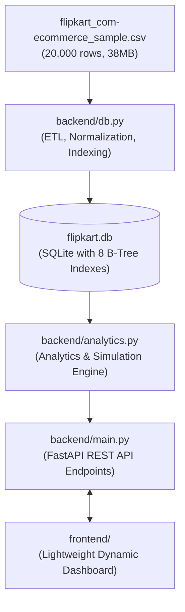

# Flipkart Catalog Analytics — Backend & Enterprise Architecture

A high-performance Python FastAPI backend and analytical database engine built for the **20,000 product Flipkart eCommerce dataset** (crawled Dec 2015 – Jun 2016).

---

## 🏗 Architecture Overview



Instead of embedding a 7.5 MB raw JSON blob directly into client-side JavaScript (which causes heavy browser freezing and page crashes), this backend:
1. **Stores and indexes** the complete 20,000 product records in SQLite (`data/flipkart.db`).
2. **Executes sub-5ms filtered queries** using B-Tree indexes on `category`, `sub_category`, `is_fk_advantage`, `brand`, `crawl_month`, `discount_pct`, and `discounted_price`.
3. **Serves REST APIs** for all analytical views, what-if scenario simulations, unit economics modeling, and paginated catalog search.

---

## 🚀 Quick Start

### 1. Requirements
- Python 3.10+
- Dependencies installed via:
```bash
pip install -r requirements.txt
```

### 2. Launch the Application
Run the startup script:
```bash
./start.sh
```
Or run directly with Uvicorn:
```bash
python3 -m uvicorn backend.main:app --host 0.0.0.0 --port 8000 --reload
```

- **Interactive Web Dashboard**: [http://localhost:8000/](http://localhost:8000/)
- **Swagger API Documentation**: [http://localhost:8000/docs](http://localhost:8000/docs)
- **ReDoc API Documentation**: [http://localhost:8000/redoc](http://localhost:8000/redoc)

---

## 📡 API Reference

### Health & Metadata
- **`GET /api/health`**: Verifies database connectivity and service status.
- **`GET /api/filters`**: Returns lists of all available primary categories, sub-categories, and top brands for filter menus.
- **`GET /api/dictionary`**: Schema and metadata definition for all 15 dataset columns.

### Analytics Endpoints (Supports `category`, `sub_category`, `fk`, `q` query filters)
- **`GET /api/analytics/overview`** (View 0):
  - Catalog KPIs (total listings, average retail/selling price, average discount %, Flipkart Advantage %, rated share, active brands).
  - Key strategic findings and natural language market anomalies.
  - Listings by category distribution (count and %).
  - Discount depth breakdown (`0%`, `1-20%`, `21-40%`, `41-60%`, `61-80%`, `>80%`).
  - Selling price bands (`<₹500`, `₹500-₹1k`, `₹1k-₹2.5k`, `₹2.5k-₹5k`, `₹5k-₹10k`, `>₹10k`).
  - Crawl month volume timeline (Dec 2015 – Jun 2016).

- **`GET /api/analytics/pricing`** (View 1):
  - Sampled Price vs Discount scatter coordinates (up to 2,500 points with Flipkart Advantage flags).
  - Average discount depth per primary category.
  - Flipkart Advantage vs Standard Seller side-by-side performance metrics.
  - Sub-category drill-down table with sorting and advantage percentages.

- **`GET /api/analytics/ratings`** (View 2):
  - Rating distribution (1 Star through 5 Stars, plus Unrated volume).
  - Average discount depth by customer star rating bracket.
  - Top 30 brand leaderboard ranked by product catalog count.

- **`POST /api/analytics/scenario`** (View 3):
  - Order demand simulator. Multiplies assumed sales units per listing to project Gross Merchandise Value (GMV), total retail MRP value, and promotional discount money given away.

- **`POST /api/analytics/unit-economics`** (View 5):
  - Financial simulator. Parameters:
    - `units_per_listing` (e.g., 5)
    - `product_cost_pct` (COGS as % of list price, e.g., 35%)
    - `commission_pct` (marketplace commission % of selling price, e.g., 8%)
    - `shipping_per_unit` (logistics cost in ₹, e.g., ₹40)
  - Returns: Gross Revenue, Total COGS, Total Commission, Total Shipping, Net Profit, Operating Margin %, Category P&L table, Profit by Crawl Month, Profit by Discount Depth, Top 10 Most Profitable and Top 10 Loss-Making items.

### Catalog Explorer
- **`GET /api/products`** (View 4):
  - Paginated search with column sorting (`name`, `category`, `retail_price`, `discounted_price`, `discount_pct`, `rating`).
  - Returns thumbnails, prices, badges, and truncated descriptions.
- **`GET /api/products/{uniq_id}`**:
  - Full product record including all gallery images, parsed key-value technical specifications, full description, and Flipkart listing URL.

---

## 🧪 Testing

Run the automated backend test suite:
```bash
python3 test_api.py
```
This tests all endpoints, verifying status codes, schema validity, and numerical aggregation accuracy.
